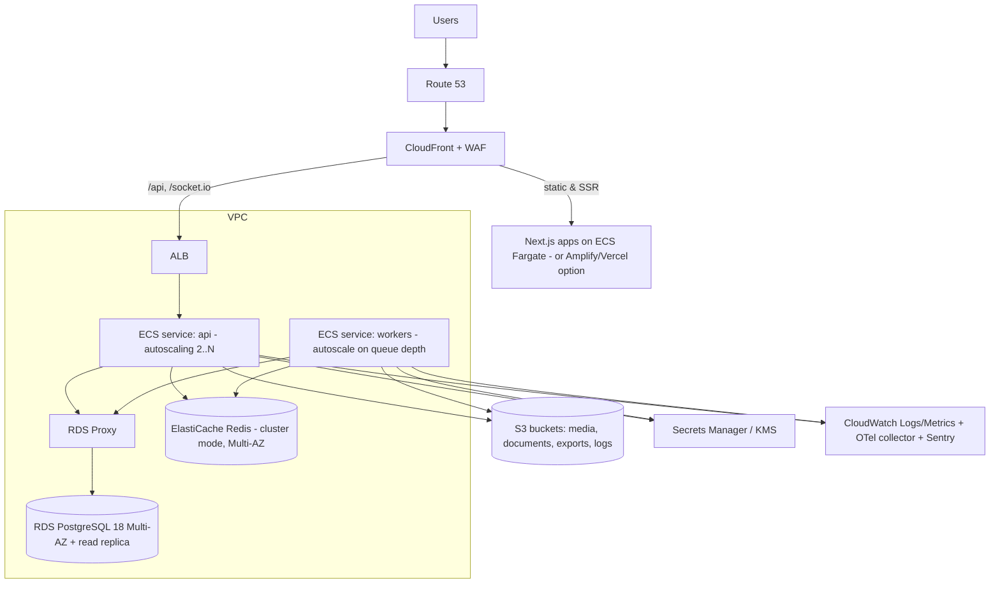

# FoodStack — Deployment & DevOps

## 1. Environments

`local` (docker-compose: Postgres 18, Redis, MinIO for S3, Mailpit) → `dev` → `staging` (prod-like, anonymised data) → `production`. Separate AWS accounts for staging and prod (AWS Organizations).

## 2. AWS topology (production)



- Private subnets for compute and data; NAT for egress; VPC endpoints for S3/Secrets Manager.
- Infrastructure as Code: Terraform modules per environment.
- Next.js apps containerised (standalone output) on ECS; the QR app could be served with aggressive CDN caching for menus.

## 3. Containers

- Multi-stage Dockerfiles, `node:26-alpine` (or distroless) base, non-root user, `pnpm deploy` for pruned production bundles via `turbo prune`.
- One API image with two entrypoints: `api` (HTTP + WS) and `worker` (BullMQ).

## 4. CI/CD (GitHub Actions)

1. **PR**: install (pnpm cache) → lint → typecheck → unit tests → integration tests (Testcontainers Postgres/Redis) → cross-tenant/RLS tests → build (Turborepo remote cache) → OpenAPI diff check → security scans.
2. **main**: build & push images to ECR (tag = git SHA) → deploy to dev automatically → run migrations as a one-off ECS task → smoke tests.
3. **release tag**: deploy to staging → E2E (Playwright) + k6 smoke → manual approval → production blue/green (CodeDeploy for ECS) with automatic rollback on alarm.

- Migrations are backward-compatible (expand/contract) so rollback of code does not require DB rollback.
- Migration task command (API image): `node node_modules/typeorm/cli.js migration:run -d dist/database/data-source.js` with `DATABASE_MIGRATION_USER/PASSWORD` set; locally the compose `migrate` service runs it before `api` starts.

### Database roles (RDS)

Created once per environment by the platform team (the RDS master user is used only for this):

```sql
CREATE ROLE foodstack_migrator LOGIN PASSWORD '…' NOSUPERUSER BYPASSRLS;  -- owns the schema; BYPASSRLS for data backfills
CREATE ROLE foodstack_app LOGIN PASSWORD '…' NOSUPERUSER NOBYPASSRLS;     -- the API and workers
GRANT CONNECT ON DATABASE foodstack TO foodstack_app;
GRANT CREATE, USAGE ON SCHEMA public TO foodstack_migrator;
REVOKE CREATE ON SCHEMA public FROM PUBLIC;
GRANT USAGE ON SCHEMA public TO foodstack_app;
ALTER DEFAULT PRIVILEGES FOR ROLE foodstack_migrator IN SCHEMA public GRANT SELECT, INSERT, UPDATE, DELETE ON TABLES TO foodstack_app;
ALTER DEFAULT PRIVILEGES FOR ROLE foodstack_migrator IN SCHEMA public GRANT USAGE, SELECT ON SEQUENCES TO foodstack_app;
ALTER DEFAULT PRIVILEGES FOR ROLE foodstack_migrator IN SCHEMA public GRANT EXECUTE ON FUNCTIONS TO foodstack_app;
```

The API refuses to start in staging/production if its role is a superuser or has `BYPASSRLS`.
`citext` and `pg_trgm` are trusted extensions, so the migrator can create them without superuser.

- Sentry release + source maps uploaded per deploy.
- GitHub OIDC → AWS IAM roles (no long-lived keys).

## 5. Operations

- Autoscaling: API on CPU/request count; workers on BullMQ queue depth (custom metric).
- Backups: see `security.md`. Restore drill quarterly.
- Feature flags for gradual rollout per tenant.
- POS PWA versions: server advertises min supported client version; incompatible clients prompted to update between orders.
