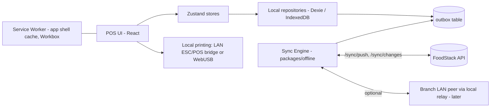

# FoodStack — Offline-First POS

Goal: a cashier can take orders, print KOTs and bills, and accept cash/card-terminal payments during an internet outage, with zero duplicate or lost records after recovery.

## 1. Components

- **PWA**: installable, app shell + assets precached; versioned updates applied only between orders.
- **IndexedDB stores**: `catalog` (products, prices, taxes, modifiers), `settings`, `tables`, `employees` (PIN hashes for offline PIN login), `orders`, `invoices`, `payments`, `outbox`, `syncState`, `printQueue`.
- **Shared domain package**: the same pricing/tax/rounding engine (`packages/domain`) runs on POS and server, so offline totals equal server totals.

## 2. Offline grant

On login while online the server issues a signed **offline grant** (device id, branch id, user permissions snapshot, valid up to e.g. 72 h, offline invoice series range). Offline actions are allowed only within that grant; expired grant → POS shows online-required.

## 3. Writes: local-first + outbox

1. Every entity is created with a **client-generated UUIDv7** and `clientRef` (`{deviceCode}-{seq}`).
2. Write goes to local store **and** an outbox entry `{opId, type, entityId, baseVersion, payload, occurredAt}` in one IndexedDB transaction.
3. Sync engine pushes in order (FIFO per entity) when online; exponential backoff; Background Sync API where supported, plus foreground timer.
4. Server processes each op idempotently (`opId` unique in `sync_ops`/`idempotency_keys`; `orders(tenant_id, source_device_id, client_ref)` unique). Replays return the original result → **duplicates impossible**.

## 4. Invoice numbering offline

Tax law usually requires sequential, gap-free numbers. Each device gets a dedicated **device invoice series** (e.g. `BLR1-P2/25-26/000123`) reserved in advance. Offline invoices consume numbers locally; server accepts them as already issued. If a tenant's jurisdiction forbids per-device series, setting `offline_invoicing = provisional`: the POS prints a provisional bill and the final invoice number is assigned on sync (configurable per tenant).

## 5. Payments offline

- **Cash**: fully supported; recorded locally against the cash drawer session.
- **Card on standalone terminal / manual UPI**: recorded as `captured` with reference entered by cashier, flagged `offline_recorded` for reconciliation.
- **Integrated gateway / online UPI**: not available offline (requires network). UI disables them.
- On sync, payments are submitted with idempotency keys; mismatch reports flagged for the accountant.

## 6. Conflict resolution

| Data                                            | Owner              | Rule                                                                                                                                                                                                 |
| ----------------------------------------------- | ------------------ | ---------------------------------------------------------------------------------------------------------------------------------------------------------------------------------------------------- |
| Catalog, prices, taxes, settings                | Server             | Server wins; POS pulls deltas via `/sync/changes`. Offline orders keep **price snapshots** used at sale time (legal truth of the sale)                                                               |
| Orders created on this device                   | Device             | Device wins for its own orders until invoiced                                                                                                                                                        |
| Shared dine-in orders (waiter + POS)            | Server             | Per-field merge: items are append-only rows (add/void events), so concurrent additions merge; status follows state machine; `baseVersion` mismatch on header → server merges and returns new version |
| Item unavailable / deleted product sold offline | —                  | Accept sale (already served), raise warning in sync report                                                                                                                                           |
| Invoices & payments                             | Device (immutable) | Never overwritten; corrections only via credit notes/refunds                                                                                                                                         |
| Stock                                           | Server             | Deductions computed server-side on sync; negative stock allowed temporarily and flagged                                                                                                              |
| Table status                                    | Server             | Last-write-wins with timestamp + manager resolution screen for double-seated tables                                                                                                                  |

## 7. Network recovery

- Connectivity detection: `navigator.onLine` + heartbeat `GET /health` every 15 s (onLine alone is unreliable).
- On recovery: push outbox (ordered) → pull changes since cursor → reconcile → reconnect Socket.IO and rejoin rooms.
- Sync status bar (online / offline / syncing N pending / errors) always visible; failed ops land in a "needs attention" queue visible to manager, never silently dropped.
- Storage safety: `navigator.storage.persist()` requested; warn at quota thresholds; outbox is never purged before server acknowledgement; daily local export option.
- Day close requires outbox empty (or manager override with report).

## 8. Kitchen during outage

KOTs print locally (LAN printer). KDS on the same LAN can receive via an optional **branch local relay** (small Node service on a mini-PC, later phase); without it, printed KOTs are the fallback.

## 9. Security offline

Local data encrypted at rest using a WebCrypto AES-GCM key (non-extractable, per device); PIN hashes only; device remote-wipe flag on next connection; offline grant limits time window and permissions.
