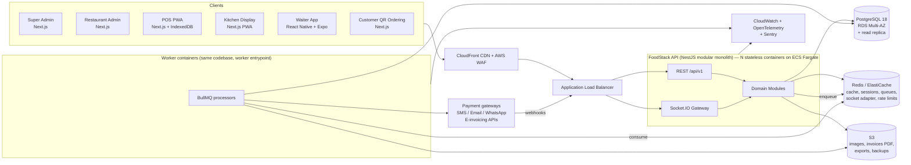
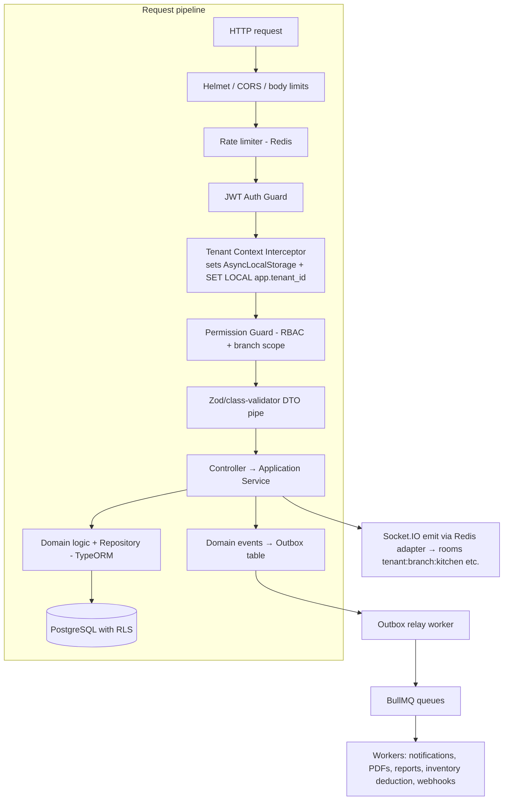

# FoodStack — System Architecture

> Status: Step 1 (architecture) — awaiting approval. No application code exists yet.

## 1. Requirement Analysis (key drivers)

| Driver                                       | Architectural consequence                                                                                                                               |
| -------------------------------------------- | ------------------------------------------------------------------------------------------------------------------------------------------------------- |
| Many independent restaurants on one platform | Multi-tenant SaaS, shared DB with `tenant_id` + PostgreSQL Row-Level Security (RLS)                                                                     |
| Chains / franchises with many branches       | Tenant → Restaurant (brand) → Branch hierarchy; per-branch settings, menus, prices, taxes, stock                                                        |
| Different business rules per restaurant      | Settings are data (JSONB + typed settings tables), never hard-coded: tax regimes, service charge, rounding, invoice numbering, KOT routing, shift rules |
| POS must keep billing when internet drops    | Offline-first PWA POS with IndexedDB + outbox sync + idempotency keys                                                                                   |
| Money correctness                            | Orders, invoices, payments and refunds are separate ledgers; immutable invoices; integer minor-unit amounts; DB transactions                            |
| Real-time kitchen/waiter flow                | Socket.IO gateway with Redis adapter, branch-scoped rooms                                                                                               |
| Small team, fast delivery, future scale      | **Modular monolith** (NestJS modules with strict boundaries) → extractable services later                                                               |

## 2. High-Level Architecture



## 3. Detailed Runtime Architecture



### Key decisions

1. **Modular monolith.** One deployable API, but each business module owns its tables, exposes a public service interface, and communicates with other modules through (a) explicit service interfaces or (b) domain events. No module queries another module's tables directly. Enforced via lint rules (`eslint-plugin-boundaries`) and Nx-style tags in Turborepo packages. This gives microservice-ready seams without distributed-system cost.
2. **Transactional outbox.** Domain events (e.g. `OrderPlaced`, `InvoiceIssued`, `PaymentCaptured`) are written in the same DB transaction as the state change, then relayed to BullMQ. Guarantees no lost side effects (stock deduction, notifications) and is the migration path to a message broker (SQS/Kafka) later.
3. **Stateless API nodes.** Sessions/refresh tokens in Postgres + Redis, Socket.IO uses `@socket.io/redis-adapter` → horizontal scaling behind ALB (sticky sessions only needed for long-polling fallback; we force WebSocket transport).
4. **API versioning.** URI versioning `/api/v1` via NestJS `VersioningType.URI`. Breaking changes → `v2` controllers coexisting; deprecation headers (`Deprecation`, `Sunset`).
5. **Read/write split.** Reports and analytics read from a replica and from pre-aggregated tables (`daily_sales_summary` etc.) built by workers. OLTP stays fast.
6. **Money.** All amounts are `BIGINT` minor units (paise/cents) + `currency_code`. No floats anywhere. Tax computed with explicit rounding mode per tenant setting.
7. **Configurable business rules.** `tenant_settings`, `restaurant_settings`, `branch_settings` with inheritance (branch overrides restaurant overrides tenant overrides platform default). Tax rules, service charge, order types enabled, invoice series, KOT printers, discount approval thresholds, etc.

## 4. Application Architecture

All frontends live in one Turborepo, share `packages/ui` (shadcn-based design system), `packages/api-client` (typed client generated from OpenAPI), `packages/validators` (Zod schemas shared with the backend), and `packages/auth`.

| App                                          | Users                                                       | Responsibility                                                                                                                                             | Backend communication                                                                                                                    |
| -------------------------------------------- | ----------------------------------------------------------- | ---------------------------------------------------------------------------------------------------------------------------------------------------------- | ---------------------------------------------------------------------------------------------------------------------------------------- |
| **Super Admin** (`apps/super-admin`)         | Platform staff                                              | Tenants, plans, subscriptions, billing of tenants, feature flags, impersonation (audited), platform health, support tooling                                | REST (platform-scoped endpoints `/api/v1/platform/*`), separate auth audience, mandatory MFA, IP allow-list                              |
| **Restaurant Admin** (`apps/web`)            | Owner, admin, branch manager, inventory manager, accountant | Restaurant/branch setup, menu, pricing, taxes, staff, tables, inventory, suppliers, CRM, loyalty, reports, settings, subscription                          | REST + TanStack Query; Socket.IO for live dashboards                                                                                     |
| **POS** (`apps/pos`)                         | Cashier, manager                                            | Touch-first billing, order types (dine-in/takeaway/delivery), split/merge bills, discounts, payments, shifts & cash drawer, KOT printing, **offline mode** | REST + sync API (`/api/v1/sync/*`), Socket.IO; IndexedDB local store; service worker                                                     |
| **Kitchen Display** (`apps/kitchen-display`) | Kitchen staff                                               | Station-wise ticket queues, item status (accepted/preparing/ready), timers, bump/recall                                                                    | Socket.IO primarily (room per branch+station), REST to update status; small offline buffer                                               |
| **Waiter** (`apps/waiter-mobile`)            | Waiters                                                     | Table map, take orders at table, send KOT, request bill, see ready items, call alerts                                                                      | REST + Socket.IO, Expo app on phones; short offline queue                                                                                |
| **Customer QR** (`apps/qr`)                  | Guests (anonymous / OTP)                                    | Scan table QR → menu → cart → place order (optionally requires waiter approval) → pay online → order status                                                | Public REST `/api/v1/public/*` with signed table token, Socket.IO room per table session; SSR for fast mobile load; heavily rate-limited |

Communication rules:

- All apps talk only to the API gateway (ALB); no direct DB or Redis access.
- Real-time events are notifications ("order 123 changed"); clients refetch or apply the payload, while REST remains the source of truth.
- Socket rooms: `t:{tenantId}:b:{branchId}`, `...:station:{stationId}`, `...:table:{tableSessionId}`, `user:{userId}`. Joining a room is authorized server-side.

## 5. Backend Module Architecture

```
apps/api/src/
  core/            config, database, redis, queue, logger, tenant-context, auth guards, outbox, errors
  modules/
    identity/      auth, users, sessions, MFA, password reset
    access/        roles, permissions, role assignments (RBAC)
    platform/      tenants, plans, subscriptions, feature flags (super admin)
    organization/  restaurants, branches, settings, tax config, devices, printers
    staff/         employees, shifts, attendance, PIN login
    catalog/       menus, categories, products, variants, modifiers, price lists
    floor/         floors, tables, table sessions, QR tokens
    ordering/      orders, order items, KOT, order state machine
    kitchen/       stations, routing rules, kitchen tickets
    billing/       invoices, invoice series, taxes, discounts, credit notes
    payments/      payments, gateway integrations, webhooks, cash drawer
    refunds/       refund requests, approvals, gateway refunds
    inventory/     stock items, units, stock ledger, transfers, wastage, stock counts
    recipes/       recipes (BOM) linking products → stock items
    procurement/   suppliers, purchase orders, goods receipts
    crm/           customers, addresses, feedback
    loyalty/       programs, points ledger, rewards, coupons
    reporting/     aggregates, reports, exports
    notifications/ templates, channels, delivery log
    audit/         audit log, security events
    sync/          offline POS sync endpoints
    realtime/      Socket.IO gateway
```

### Module catalogue

| Module                                                | Purpose                      | Main responsibilities                                                                                                            | Depends on                                  |
| ----------------------------------------------------- | ---------------------------- | -------------------------------------------------------------------------------------------------------------------------------- | ------------------------------------------- |
| Authentication & Authorization (`identity`, `access`) | Who you are, what you may do | Login (email/password, staff PIN on registered device), JWT issuing, refresh rotation, MFA, roles, permissions, scope checks     | audit, notifications                        |
| Tenant management (`platform`)                        | SaaS customer lifecycle      | Tenant provisioning, status (trial/active/suspended), limits, feature flags                                                      | subscription, identity                      |
| Restaurant management (`organization`)                | Brand-level configuration    | Restaurants (brands), legal entity, tax registration, currency, timezone, settings inheritance                                   | platform                                    |
| Branch management (`organization`)                    | Outlet-level operations      | Branches, operating hours, devices, printers, branch settings overrides                                                          | restaurant                                  |
| Employee management (`staff`)                         | Workforce                    | Employee profiles, branch assignments, shifts, attendance, PINs                                                                  | identity, access, organization              |
| Menu management (`catalog`)                           | What can be sold where/when  | Menus per channel (dine-in, takeaway, QR, delivery), time-based availability, branch overrides                                   | organization                                |
| Category & product (`catalog`)                        | Sellable items               | Categories, products, variants (size), modifier groups, tax category, price lists per branch/channel, images (S3)                | organization                                |
| POS & billing (`ordering` + `billing`)                | Front-of-house money flow    | Cart → order → invoice; discounts; split/merge; service charge; rounding                                                         | catalog, floor, billing, payments           |
| Order management (`ordering`)                         | Lifecycle of an order        | State machine: `draft → placed → in_kitchen → ready → served → completed / cancelled`, KOTs, voids with reason                   | catalog, floor, kitchen, inventory (events) |
| Table & floor (`floor`)                               | Dine-in layout               | Floors, tables, capacity, table sessions (occupy/merge/transfer), QR tokens                                                      | organization                                |
| Kitchen (`kitchen`)                                   | Back-of-house execution      | Stations, routing rules (category → station), tickets, status, prep timing                                                       | ordering, realtime                          |
| Payment (`payments`)                                  | Money received               | Payment methods per branch, gateway intents, cash/card/UPI/wallet, webhooks, cash drawer sessions, reconciliation                | billing                                     |
| Invoice (`billing`)                                   | Legal tax document           | Sequential gap-free numbering per series, immutable once issued, tax breakdown, PDF, e-invoice hooks                             | ordering, organization (tax)                |
| Refund (`refunds`)                                    | Money returned               | Refund against a payment, approval workflow, credit note in billing, gateway refund                                              | payments, billing, access                   |
| Inventory (`inventory`)                               | Stock                        | Stock items, UoM conversions, append-only stock ledger, stock per branch/warehouse, transfers, wastage, counts, low-stock alerts | recipes, procurement, notifications         |
| Recipe (`recipes`)                                    | Cost & consumption           | BOM per product/variant/modifier, yield, theoretical food cost; drives deduction on `OrderCompleted`                             | catalog, inventory                          |
| Supplier (`procurement`)                              | Purchasing                   | Suppliers, purchase orders, goods receipt notes (GRN) → stock-in, supplier bills                                                 | inventory                                   |
| Customer CRM (`crm`)                                  | Guest knowledge              | Customer profiles (per tenant), phone dedupe, visit history, feedback, consent flags                                             | ordering, billing                           |
| Loyalty & rewards (`loyalty`)                         | Retention                    | Programs configurable per restaurant, points ledger, tiers, coupons, redemption at POS                                           | crm, billing                                |
| Reports & analytics (`reporting`)                     | Insight                      | Sales, item, category, tax, payment-mode, staff, inventory variance, food cost; scheduled exports                                | read replica, all domain events             |
| Subscription (`platform`)                             | Platform revenue             | Plans, limits (branches, devices, users), billing cycle, payment provider (e.g. Stripe/Razorpay), dunning, entitlements          | platform, notifications                     |
| Notification (`notifications`)                        | Messaging                    | Email/SMS/WhatsApp/push/in-app, templates per tenant, delivery log, retries via BullMQ                                           | —                                           |
| Audit & security (`audit`)                            | Accountability               | Append-only audit log of sensitive actions, login history, security events, data export/erasure requests                         | all                                         |

## 6. Cross-cutting Concerns

- **Background jobs (BullMQ):** queues `notifications`, `documents` (invoice PDF), `inventory` (deductions), `reports`, `webhooks-in`, `webhooks-out`, `sync`, `scheduled` (repeatable: day close, aggregates, subscription renewals). Each job carries `tenantId` and runs in tenant context; idempotent handlers; exponential backoff; dead-letter queue + alert.
- **Real-time:** Socket.IO namespace per app type (`/pos`, `/kds`, `/waiter`, `/qr`, `/admin`), JWT auth on handshake, Redis adapter, server emits after DB commit (from outbox relay to avoid phantom events).
- **Logging:** Pino JSON logs with `requestId`, `tenantId`, `branchId`, `userId`; shipped to CloudWatch Logs (optionally OpenSearch/Grafana Loki). No PII/card data in logs (redaction list).
- **Tracing & metrics:** OpenTelemetry SDK → AWS X-Ray/Grafana Tempo; Prometheus-format metrics (latency, queue depth, sync lag).
- **Error tracking:** Sentry for API, workers and all frontends, with release tags from CI.
- **Audit trails:** see `security.md`; `audit_logs` is append-only (no UPDATE/DELETE grants).
- **Backups:** RDS automated backups (PITR, 35 days) + daily snapshot copied cross-region; S3 versioning + lifecycle; quarterly restore drills.
- **Horizontal scaling:** API and workers scale independently on ECS (CPU + queue depth); Postgres vertical + read replicas, later partitioning of large tables (`orders`, `order_items`, `stock_ledger`, `audit_logs`) by month; PgBouncer/RDS Proxy for connections.

## 7. Path to Microservices

Extraction candidates in order (when load or team size justifies): `notifications` → `reporting` → `payments` → `kitchen/realtime`. Prerequisites already in place: module-owned schemas, events via outbox, typed client contracts, no cross-module joins. Replace in-process event bus with SQS/SNS or Kafka; replace module service calls with HTTP/gRPC clients behind the same interfaces.

## 8. Technology Versions

Target stack (pin exact versions in Step 2 after verifying current stable releases and peer-compatibility at install time):

| Layer            | Choice                                                                                                                                        |
| ---------------- | --------------------------------------------------------------------------------------------------------------------------------------------- |
| Runtime          | Node.js 26 LTS (fallback Node 24 LTS if any dependency lacks support)                                                                         |
| Package/monorepo | pnpm 10.x, Turborepo 2.x                                                                                                                      |
| Frontend         | Next.js 16 (App Router), React 19, TypeScript 5.x, Tailwind CSS 4, shadcn/ui, Zustand 5, TanStack Query 5, React Hook Form 7, Zod 4, Recharts |
| Backend          | NestJS 11, `@nestjs/swagger`, `@nestjs/websockets` + Socket.IO 4, TypeORM 0.3.x, BullMQ 5                                                     |
| Data             | PostgreSQL 18 (RDS), Redis 7.x / Valkey (ElastiCache)                                                                                         |
| Infra            | Docker, AWS (ECS Fargate, RDS, ElastiCache, S3, CloudFront, WAF, Secrets Manager, KMS), GitHub Actions, Terraform (IaC)                       |

Rule: no dependency is added without checking its latest stable release, Node 26 support and peer ranges (notably TypeORM ↔ `pg`, Next 16 ↔ React 19 ↔ shadcn/Tailwind 4, Zod 4 ↔ `@hookform/resolvers`).

## 9. Recommended Folder Structure

> Status: implemented so far are `apps/{api,web,pos,kitchen-display,qr,waiter-mobile}` and `packages/{ui,types,validators,api-client,utils,config,eslint-config}` (`types` + `utils` hold what the plan calls `domain` until the order state machine arrives). `infrastructure/aws` replaces `infrastructure/terraform`; cross-app tests live in `tests/{integration,e2e}`; `super-admin`, `auth`, `offline`, `testing` are added in their phases.

```
foodstack/
├─ apps/
│  ├─ api/                 NestJS (http + ws entrypoint, worker entrypoint)
│  ├─ super-admin/         Next.js
│  ├─ web/                 Next.js (restaurant admin)
│  ├─ pos/                 Next.js PWA
│  ├─ kitchen-display/     Next.js PWA
│  ├─ waiter-mobile/       React Native + Expo
│  └─ qr/                  Next.js (public)
├─ packages/
│  ├─ ui/                  design system (shadcn components, tokens, charts)
│  ├─ api-client/          generated OpenAPI client + TanStack Query hooks
│  ├─ validators/          shared Zod schemas & DTO types
│  ├─ domain/              shared enums, money/tax utils, order state machine (pure TS)
│  ├─ auth/                frontend auth helpers, permission checks
│  ├─ offline/             IndexedDB (Dexie) stores, outbox, sync engine
│  ├─ config/              tsconfig, tailwind presets
│  ├─ eslint-config/       shared ESLint flat configs
│  └─ testing/             fixtures, factories
├─ infrastructure/
│  ├─ docker/              Dockerfiles, docker-compose (local: pg, redis, minio, mailpit)
│  └─ terraform/           AWS environments (dev, staging, prod)
├─ tests/
│  ├─ integration/
│  └─ e2e/
├─ docs/
├─ .github/workflows/      ci.yml, deploy-*.yml
├─ turbo.json
└─ pnpm-workspace.yaml
```

## 10. Major Technical Risks & Mitigations

| Risk                                            | Impact                    | Mitigation                                                                                                                     |
| ----------------------------------------------- | ------------------------- | ------------------------------------------------------------------------------------------------------------------------------ |
| Cross-tenant data leak                          | Critical (legal, trust)   | RLS on every tenant table + app-level tenant filter + automated tests that try cross-tenant access on every endpoint           |
| Offline duplicate / lost orders                 | Revenue loss, wrong stock | Client-generated UUIDv7 ids + idempotency keys, server upsert semantics, sync ledger, reconciliation report                    |
| Invoice number gaps/duplicates (tax compliance) | Legal                     | Per-device offline series prefixes, server sequence in locked counter row, invoices immutable, corrections via credit notes    |
| Money rounding errors                           | Financial                 | Integer minor units, single tax engine in `packages/domain` used by POS and server, golden tests                               |
| Version incompatibility in bleeding-edge stack  | Delivery delay            | Verify & pin versions; Renovate with CI; fallback to previous LTS                                                              |
| TypeORM limitations at scale                    | Performance               | Use query builder/raw SQL for hot paths & reports; migrations only (no `synchronize`); consider Kysely for reporting if needed |
| Real-time fan-out at peak (Friday dinner)       | KDS lag                   | Redis adapter, small payloads, room scoping, load testing (k6)                                                                 |
| Payment webhook loss/duplication                | Mismatched states         | Store raw webhooks, idempotent processing by gateway event id, periodic reconciliation job                                     |
| Per-country tax/regulation variety              | Rework                    | Pluggable tax engine & invoice-format strategy per country; launch with one country                                            |
| Noisy neighbour tenants                         | Platform slowness         | Per-tenant rate limits, queue fairness (BullMQ groups), large-tenant isolation option (dedicated DB) later                     |
| Monolith boundary erosion                       | Hard to split later       | Lint-enforced module boundaries, architecture tests, code review checklist                                                     |
